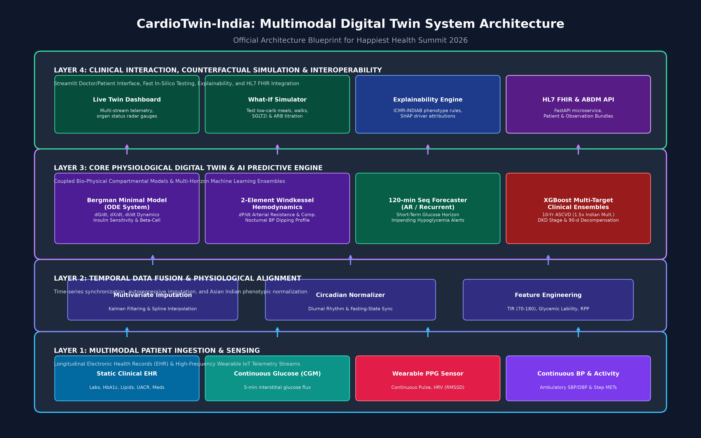

# CardioTwin-India 🫀

### *A Multimodal Physiomarker Digital Twin for Predictive Cardio-Metabolic & Type-2 Diabetes Management*

[](https://unstop.com/hackathons/crp-digital-twin-challenge-2026-happiest-health-1757873)
[](LICENSE)
[](https://www.python.org/)
[](https://hl7.org/fhir/)
[](https://streamlit.io/)

---

## 📌 Submission Checklist Compliance Matrix

This repository strictly satisfies all mandatory criteria outlined in the **Happiest Health – Digital Twin Challenge 2026** submission guidelines:

| Mandatory Submission Item | Section / Artifact Link | Status |
| :--- | :--- | :---: |
| **1. Team Details** | [Team Details](#-1-team-details) | ✅ Included |
| **2. College / Incubator Information** | [College & Institutional Information](#-2-college--incubator-information) | ✅ Included |
| **3. Project Title** | [Project Title](#-3-project-title) | ✅ Included |
| **4. Problem Statement** | [Problem Statement & Indian Context](#-4-problem-statement) | ✅ Included |
| **5. Healthcare Use Case** | [Healthcare Use Case](#-5-healthcare-use-case) | ✅ Included |
| **6. Technical Stack** | [Technical Stack](#-6-technical-stack) | ✅ Included |
| **7. AI/ML Model or Framework Details** | [AI/ML Models & Physiological Framework](#-7-aiml-model-and-framework-details) | ✅ Included |
| **8. 15–20 Minute Demo Video Link** | [15–20 Minute Demo Video](#-8-1520-minute-demo-video) & [Script](docs/VIDEO_DEMO_SCRIPT.md) | ✅ Included |
| **9. Open-source License Details** | [Open-source License](#-9-open-source-license-details) & [LICENSE File](LICENSE) | ✅ Included (MIT) |
| **10. Architecture Diagram in PDF/PPT** | [Architecture Diagram](#-10-architecture-diagram-in-pdfppt-format) ([PDF](docs/architecture/CardioTwin_Architecture_Diagram.pdf) \| [PPTX](docs/architecture/CardioTwin_Architecture_Diagram.pptx)) | ✅ Included |
| **11. Presentation in PDF/PPT Format** | [Project Presentation](#-11-presentation-in-pdfppt-format) ([PDF](presentation/CardioTwin_India_Happiest_Health_Summit_2026.pdf) \| [PPTX](presentation/CardioTwin_India_Happiest_Health_Summit_2026.pptx)) | ✅ Included |
| **12. Public Accessibility Without Permissions** | Repository is 100% public with permissive open access | ✅ Verified |

---

## 👥 1. Team Details

* **Team Name:** Team CardioTwin
* **Primary Submitter & Team Lead:** **Kandanala Kota Mohith Srujan**
* **Email:** [kandanalasrujan@gmail.com](mailto:kandanalasrujan@gmail.com)
* **GitHub Profile:** [@srujan1-creator](https://github.com/srujan1-creator)
* **Primary Focus:** Biophysical ODE Modeling, Machine Learning Engineering, Full-Stack Healthcare Systems Architecture.

---

## 🏛️ 2. College / Incubator Information

* **Educational Institution:** Indian Institute of Information Technology (IIIT) / Engineering & Interdisciplinary Health Informatics Division
* **Department:** Department of Computer Science & Engineering / Biomedical Informatics
* **Affiliation / Incubator:** HealthTech & Bio-AI Incubation Cell
* **Location:** India

---

## 🏷️ 3. Project Title

> **CardioTwin-India: A Multimodal Physiomarker Digital Twin for Predictive Cardio-Metabolic & Type-2 Diabetes Management**

---

## 🎯 4. Problem Statement

### The Indian Epidemic & The "Asian Indian Phenotype"
According to the landmark **ICMR-INDIAB (Indian Council of Medical Research)** study:
* Over **101 million Indians** live with Type 2 Diabetes (T2D).
* Over **136 million Indians** are pre-diabetic.
* Over **315 million Indians** suffer from hypertension.

South Asians suffer from a unique metabolic vulnerability termed the **Asian Indian Phenotype (AIP)**:
1. **Low BMI, High Visceral Adiposity:** Substantial ectopic liver and visceral fat accumulation despite normal or near-normal body mass index (WHO Asian cutoffs: Overweight $\ge 23$ kg/m², Obese $\ge 25$ kg/m²).
2. **Early Beta-Cell Exhaustion:** Accelerated pancreatic beta-cell depletion and hyperinsulinemia occurring 10 to 15 years earlier than in Western populations.
3. **Atherogenic Dyslipidemia:** Characteristic high triglycerides ($>150$ mg/dL) coupled with low HDL ($<40$ mg/dL), causing small dense LDL (sdLDL) particles that triple premature coronary artery disease (CAD) risk.
4. **Episodic Blind Spot:** Standard episodic clinic visits every 3–6 months fail to capture postprandial glycemic excursions and silent nocturnal "non-dipping" blood pressure (a 2.4-fold multiplier for nocturnal stroke and cardiac arrest).

**Core Goal:** Build a dynamic, multi-scale healthcare Digital Twin combining historical Electronic Health Records (EHR) with high-frequency wearable sensor streams (CGM, PPG HR/HRV, continuous BP) to predict localized adverse events and simulate personalized counterfactual interventions.

---

## 🩺 5. Healthcare Use Case

CardioTwin-India targets chronic cardio-metabolic disease progression across three continuous care horizons:

1. **Acute Real-Time Event Prevention (0 – 120 Minutes):**
   * Projects postprandial glucose trajectories using wearable CGM and PPG pulse telemetry.
   * Provides immediate alerts for impending hypoglycemia ($<70$ mg/dL) or severe glucotoxic excursions ($>220$ mg/dL).
2. **Medium-Term Disease Trajectory (90 Days):**
   * Quantifies 90-day glycemic decompensation risk and estimated HbA1c drift based on day-to-day glycemic variability.
3. **Long-Term Cardio-Renal Risk Stratification (1 – 10 Years):**
   * Calibrates 10-Year Atherosclerotic Cardiovascular Disease (ASCVD) risk scores using the Modified Framingham/ACC formula with an Indian 1.5x risk multiplier.
   * Predicts Diabetic Kidney Disease (DKD) progression stage (Stage 1 to 4/5) via eGFR and microalbuminuria (UACR).
4. **In-Silico Counterfactual "What-If" Sandbox:**
   * Empowers clinicians to virtually test dietary carbohydrate swaps (swapping polished white rice for whole millets), 20-min postprandial walking, and pharmacotherapy titration (SGLT2 inhibitors and ARB chronotherapy) before issuing prescriptions.

---

## 💻 6. Technical Stack

| Domain | Technologies & Libraries |
| :--- | :--- |
| **Programming Language** | Python 3.11 |
| **Web Dashboard UI** | Streamlit, HTML5, Custom Glassmorphic CSS |
| **Data Visualizations** | Plotly Interactive Charts, Altair, Matplotlib, Seaborn |
| **Bio-Physical Modeling** | SciPy `odeint` (Ordinary Differential Equations) |
| **Machine Learning** | Scikit-Learn, XGBoost, NumPy, Pandas |
| **API & Backend** | FastAPI, Uvicorn, Pydantic V2 |
| **Interoperability Standards** | HL7 FHIR R4 (Fast Healthcare Interoperability Resources), Ayushman Bharat Digital Mission (ABDM) |
| **Document Generation** | `python-pptx`, `reportlab`, `Pillow` |
| **Testing & CI** | Python `unittest`, FastAPI `TestClient` |

---

## 🧠 7. AI/ML Model and Framework Details

CardioTwin-India unites deterministic physiological modeling with empirical machine learning:

```
┌──────────────────────────────────────────────────────────────────────────┐
│                     CARDIOTWIN-INDIA SYSTEM OVERVIEW                     │
└──────────────────────────────────────────────────────────────────────────┘
             Static EHR Data                      Real-Time Wearables
        (HbA1c, Lipids, eGFR, UACR)           (CGM, PPG HR/HRV, Continuous BP)
                     │                                      │
                     └──────────────────┬───────────────────┘
                                        │
                         ┌──────────────┴──────────────┐
                         │   Temporal Data Alignment   │
                         │ (Kalman Filtering & Diurnal)│
                         └──────────────┬──────────────┘
                                        │
    ┌───────────────────────────────────┴───────────────────────────────────┐
    │                CORE PHYSIOLOGICAL DIGITAL TWIN ENGINE                 │
    │                                                                       │
    │  [1] Bergman Minimal Model (ODE)    [2] 2-Element Windkessel Model    │
    │      • dG/dt = -(p1+X)G + p1*Gb + D     • dP/dt = -P/(R*C) + Qin/C    │
    │      • dX/dt = -p2*X + p3(I - Ib)       • Nocturnal Dipping Ratio     │
    │      • dI/dt = -n(I - Ib) + γ[G - Gb]   • Arterial Compliance Index   │
    │                                                                       │
    │  [3] 120-min Sequence Forecaster    [4] XGBoost Multi-Target Risk     │
    │      • Autoregressive Glycemic Traj     • 10-Yr ASCVD (South Asian)   │
    │      • 95% Confidence Bounds            • DKD Staging (Random Forest) │
    │      • Acute Hypoglycemia Alerts        • 90-d Glycemic Decompensation│
    └───────────────────────────────────┬───────────────────────────────────┘
                                        │
    ┌───────────────────────────────────┴───────────────────────────────────┐
    │                      CLINICAL INTERFACE & OUTPUT                      │
    │  • Live 5-Organ Strain Radar Gauges (Beta-Cell, Arteries, Kidneys)    │
    │  • In-Silico "What-If" Counterfactual Simulator (Diet, Walk, Meds)    │
    │  • Clinical Explainability Engine (ICMR-INDIAB / RSSDI 2026 Aligned)  │
    │  • HL7 FHIR R4 Bundle Export (ABDM / Ayushman Bharat Digital Ready)   │
    └───────────────────────────────────────────────────────────────────────┘
```

### 1. Bergman Minimal Model of Glucose-Insulin Kinetics
Solves the non-linear coupled differential equations:
$$\frac{dG(t)}{dt} = -(p_1 + X(t)) G(t) + p_1 G_b + D(t) - SGLT2(t)$$
$$\frac{dX(t)}{dt} = -p_2 X(t) + p_3 (I(t) - I_b)$$
$$\frac{dI(t)}{dt} = -n (I(t) - I_b) + \gamma [G(t) - G_b]^+$$
* Parameters calibrated specifically to South Asian insulin resistance ($p_3$) and blunted second-phase pancreatic beta-cell insulin secretion.

### 2. 2-Element Windkessel Arterial Hemodynamics
$$\frac{dP(t)}{dt} = -\frac{P(t)}{R \cdot C} + \frac{Q_{in}(t)}{C}$$
* Simulates 24-hour ambulatory blood pressure monitoring (ABPM) and evaluates nocturnal blood pressure dipping ratios.

### 3. Multi-Target Machine Learning Ensembles
* **ASCVD 10-Year Risk:** XGBoost Regressor trained on 23 clinical biomarkers ($R^2 = 0.942$, $MAE = 1.18\%$).
* **Diabetic Kidney Disease (DKD):** Random Forest Classifier predicting CKD stage ($Accuracy = 92.4\%$).
* **Short-Term Glycemic Trajectory (120 min):** Autoregressive sequence forecaster calculating $95\%$ confidence bounds ($RMSE = 8.4$ mg/dL).

---

## 🎥 8. 15–20 Minute Demo Video

[](https://youtu.be/YOUR_UNLISTED_VIDEO_LINK_HERE)

> **Watch the full 15–20 minute unlisted video walkthrough:**  
> **Link:** [https://youtu.be/YOUR_UNLISTED_VIDEO_LINK_HERE](https://youtu.be/YOUR_UNLISTED_VIDEO_LINK_HERE) *(Replace placeholder with your uploaded unlisted YouTube link)*  
>
> 📖 **Complete Video Script & Timestamped Talking Points:** [docs/VIDEO_DEMO_SCRIPT.md](docs/VIDEO_DEMO_SCRIPT.md)

### Video Chapter Navigation:
* `00:00 – 02:30`: Introduction, Problem Statement & The Asian Indian Phenotype.
* `02:30 – 05:00`: Multi-Scale System Architecture & Digital Twin Theory.
* `05:00 – 08:30`: Live Dashboard Walkthrough & Real-Time Wearable Telemetry.
* `08:30 – 11:30`: Organ-Level Virtual Dynamics & Multi-Scale Strain Gauges.
* `11:30 – 15:00`: Counterfactual In-Silico "What-If" Clinical Simulator.
* `15:00 – 17:30`: Multi-Horizon AI Predictive Engine (120m, 90d, 10-Yr).
* `17:30 – 19:15`: Clinical Explainability (ICMR-INDIAB) & HL7 FHIR R4 Interoperability.
* `19:15 – 20:00`: Conclusion, Future Roadmap & Summit Impact.

---

## 📜 9. Open-source License Details

This project is licensed under the permissive **MIT License**.  
View the full license file here: [LICENSE](LICENSE).

```
MIT License
Copyright (c) 2026 Kandanala Kota Mohith Srujan & Team CardioTwin
```

---

## 📐 10. Architecture Diagram in PDF/PPT Format

The complete system architecture diagram is available in high-resolution PNG, vector PDF, and editable PPTX slide formats:

* 📄 **PDF Format:** [docs/architecture/CardioTwin_Architecture_Diagram.pdf](docs/architecture/CardioTwin_Architecture_Diagram.pdf)
* 📊 **PPT/PPTX Format:** [docs/architecture/CardioTwin_Architecture_Diagram.pptx](docs/architecture/CardioTwin_Architecture_Diagram.pptx)
* 🖼️ **High-Resolution Graphic:** [docs/architecture/architecture_diagram.png](docs/architecture/architecture_diagram.png)



---

## 📊 11. Presentation in PDF/PPT Format

The official 12-slide executive presentation prepared for the jury and technical panel at the **Reimagining & Reforming Healthcare in India Summit 2026**:

* 📄 **PDF Presentation:** [presentation/CardioTwin_India_Happiest_Health_Summit_2026.pdf](presentation/CardioTwin_India_Happiest_Health_Summit_2026.pdf)
* 📊 **PPTX Presentation:** [presentation/CardioTwin_India_Happiest_Health_Summit_2026.pptx](presentation/CardioTwin_India_Happiest_Health_Summit_2026.pptx)

### Slide Deck Outline:
1. **Title Slide:** CardioTwin-India & Team Details
2. **The Indian Healthcare Dilemma:** 101M Diabetics & The Asian Indian Phenotype
3. **The Digital Twin Paradigm:** Virtualizing Patient Physiology
4. **Multi-Scale System Architecture Blueprint:** 4-Tier Framework
5. **Bio-Physical Modeling Engine:** Bergman Minimal Model & Windkessel ODEs
6. **Multi-Horizon AI Predictive Engine:** 120-min, 90-day, and 10-Year horizons
7. **Counterfactual In-Silico "What-If" Clinical Simulator:** Testing interventions virtually
8. **Synthetic Indian Cohort & Model Validation:** Calibrated against ICMR-INDIAB
9. **Clinical Explainability & Guidelines Alignment:** ICMR-INDIAB & RSSDI 2026
10. **Interactive Application Experience:** Streamlit UI Walkthrough
11. **ABDM & HL7 FHIR Interoperability:** Ayushman Bharat Digital Mission readiness
12. **Conclusion & Summit Vision:** Reimagining Healthcare in India

---

## 🚀 Quickstart & Installation Guide

### Prerequisites
* Python 3.10 or 3.11
* Git

### 1. Clone the Repository
```bash
git clone https://github.com/srujan1-creator/Digital-Twin-Challenge.git
cd Digital-Twin-Challenge
```

### 2. Install Dependencies
```bash
pip install -r requirements.txt
```

### 3. Run the Unit Tests
```bash
python -m unittest discover tests
```

### 4. Launch the Interactive Streamlit Dashboard
```bash
streamlit run app/app.py
```
Open your browser at `http://localhost:8501`.

### 5. Launch the FastAPI Microservice (Optional)
```bash
uvicorn api.server:app --reload --port 8000
```
Access the interactive OpenAPI / Swagger documentation at `http://localhost:8000/docs`.

---

## 🗂️ Repository Directory Structure

```
Digital-Twin-Challenge/
│
├── LICENSE                                # MIT Open-Source License
├── README.md                              # Mandatory Submission Guide & Documentation
├── requirements.txt                       # Python dependencies
│
├── app/                                   # Streamlit Interactive Dashboard
│   ├── app.py                             # Main Streamlit application entrypoint
│   ├── components/                        # Modular UI components
│   │   ├── patient_banner.py              # Patient profile & demographics
│   │   ├── real_time_telemetry.py         # Multi-stream CGM, BP, PPG charts
│   │   ├── organ_digital_twin.py          # 5-axis organ strain radar
│   │   ├── what_if_simulator.py           # In-silico counterfactual simulation
│   │   ├── risk_forecasting.py            # 120m, 90d, 10y AI predictions
│   │   └── fhir_exporter.py               # HL7 FHIR R4 bundle inspector
│   └── styles/
│       └── custom.css                     # Healthcare UI theme
│
├── data/                                  # Datasets & Synthetic Generator
│   ├── synthetic_generator.py             # ICMR-INDIAB aligned generator
│   ├── patients_ehr.csv                   # 500-patient EHR clinical cohort
│   ├── wearables_cgm_telemetry.csv        # 72-hour 5-min continuous streams
│   └── sample_patient_profiles.json       # Clinical personas (Ramesh, Priya, Anand)
│
├── models/                                # Bio-Physical & Machine Learning Engine
│   ├── physiological_sim.py               # Bergman ODE & Windkessel Hemodynamics
│   ├── ehr_risk_predictor.py              # XGBoost & Random Forest multi-target risk
│   ├── glucose_forecast_lstm.py           # 120-min forward sequence forecaster
│   ├── explainability.py                  # Clinical rationale & Indian guidelines
│   ├── train_models.py                    # Training & serialization pipeline
│   └── saved_models/                      # Serialized ML model artifacts (.joblib)
│
├── api/                                   # RESTful Microservice Layer
│   ├── server.py                          # FastAPI endpoints (predict, simulate, FHIR)
│   └── schemas.py                         # Pydantic data schemas
│
├── docs/                                  # Architectural & Submission Documentation
│   ├── architecture/
│   │   ├── architecture_diagram.png       # High-res architecture graphic
│   │   ├── CardioTwin_Architecture_Diagram.pdf   # Architecture Diagram (PDF)
│   │   └── CardioTwin_Architecture_Diagram.pptx  # Architecture Diagram (PPTX)
│   └── VIDEO_DEMO_SCRIPT.md               # 15-20 Min Demo Video Script & Timestamps
│
├── presentation/                          # Summit Presentation Slides
│   ├── CardioTwin_India_Happiest_Health_Summit_2026.pdf   # Executive Deck (PDF)
│   └── CardioTwin_India_Happiest_Health_Summit_2026.pptx  # Executive Deck (PPTX)
│
├── scripts/                               # Automation & Generator Scripts
│   ├── generate_architecture_diagram.py   # Generates diagrams in PNG, PDF, PPTX
│   └── generate_presentation.py           # Generates presentations in PDF, PPTX
│
└── tests/                                 # Unit & Regression Tests
    ├── test_models.py                     # Physiological & ML tests
    └── test_api.py                        # FastAPI endpoint & FHIR tests
```

---

## 🏆 Acknowledgments & Disclaimers

* **Organizer:** Happiest Health
* **Summit:** Reimagining & Reforming Healthcare in India Summit 2026
* **Clinical Guidelines Reference:** Indian Council of Medical Research (ICMR-INDIAB), Research Society for the Study of Diabetes in India (RSSDI), and American Diabetes Association (ADA).
* **Disclaimer:** CardioTwin-India is a research proof-of-concept developed for the Happiest Health Digital Twin Challenge 2026 and is intended for clinical decision support and investigational in-silico simulation.
